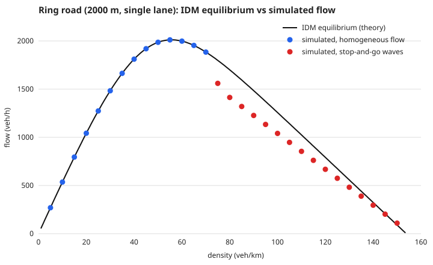

# Validation report

Every claim below is enforced by an automated test in `engine/test/` (run `npm test`) or regenerated
by a script in `engine/scripts/`. Default driver parameters are typical urban IDM values:
`v0 = 15 m/s (54 km/h), T = 1.0 s, a = 1.0 m/s², b = 1.5 m/s², s0 = 2 m, δ = 4`, vehicle length 4.5 m,
time step `dt = 0.25 s`.

## Phase 1: single lane

### 1. Fundamental diagram (ring road)

Data: [`validation/fundamental-diagram.csv`](validation/fundamental-diagram.csv). Regenerate with
`cd engine && npx tsx scripts/fundamental-diagram.ts`. Setup: a 2 km single-lane ring, 30 min warm-up,
then 2 h of measurement, with one vehicle displaced 1 m to seed instabilities.

| Finding | Evidence |
|---|---|
| **Lane capacity ≈ 2,012 veh/h at 56 veh/km.** This is in the expected 1,800–2,200 veh/h/lane range. | `idm.test.ts` |
| **At 5–60 veh/km the simulated flow matches IDM equilibrium to within 0.1%** (test tolerance 1%). | `roadSim.test.ts` "stable density" |
| **At 65 veh/km and above, stop-and-go waves form.** Vehicles come to a full stop, and flow drops 20–35% below the homogeneous equilibrium. This is the known string instability of IDM with these parameters, i.e. a capacity drop. | "unstable density" tests |
| **In the wave regime, the simulated points lie on a straight congested branch.** The line reaches zero at about 159 veh/km, which is exactly the density of vehicles queued at the observed jam gap of 1.79 m (1000 / (1.79 + 4.5) ≈ 159). | CSV |
| **Near jam density (150 veh/km), the simulation beats the equilibrium curve** (125 vs 90 veh/h). This is not an error. The equilibrium assumes equal gaps, but stopped vehicles compress to 1.2–1.8 m (below s0, a known IDM property when braking to a stop). That leaves more room for the moving vehicles. The gap always stays positive. | CSV, `min_gap_m` column |

**Two independent flow measurements.** The script computes flow both as space-mean speed × density
(Edie) and with a point detector. In stable flow they agree within 0.1%. In the wave regime they
initially disagreed by **12%** over a 30-minute window. Investigation showed this is a measurement
artefact, not an engine bug. On a ring, the detector count has an error of up to *n* crossings
(one per vehicle), i.e. ±400 veh/h for 200 vehicles over 30 min. With a 2 h window the error bound is
100 veh/h, and the two measures agree within 0.2%. The wave-regime tests therefore use 2 h windows.

### 2. Safety invariants

| Invariant | Test |
|---|---|
| No collisions: the bumper-to-bumper gap is > 0 for every pair at every step | jammed ring at dt = 0.1, 0.25 and 0.5 s; oversaturated open road |
| Speeds are never negative or non-finite | same (`badState` flag) |
| Vehicle conservation: entered = exited + in network, checked **every step** | oversaturated open road, 1 h |
| Determinism: the same seed gives a bit-identical state hash, and different seeds differ | `determinism` tests |

The ballistic integrator (Treiber & Kanagaraj 2015) stops a vehicle *at* its stopping point instead of
letting naive Euler push the speed negative. This is unit tested.

### 3. Entrance (source) capacity: a bug found and fixed

The first insertion rule inserted a waiting vehicle as soon as the gap was ≥ s0 + 1 m, at the equilibrium
speed for that gap. Under oversaturated demand, the entrance discharged only **1,187 veh/h**.
Every entrant started from near standstill, so the entrance behaved like the front of a jam, and the
outflow from a jam is well below capacity. In the network this would have quietly capped every
source at about 1,200 veh/h/lane.

Four rules compared (3,000 veh/h demand, 1 h, 1.5 km road):

| Rule | Entrance flow (veh/h) | Hardest braking |
|---|---|---|
| A. equilibrium speed for gap, gap ≥ s0 + 1 (original) | 1,221 | 0.00 m/s² |
| **B. leader's speed, gap ≥ s0 + vT (adopted)** | **2,009** | 0.73 m/s² |
| C. like A, but wait until speed ≥ 0.8 × leader | 1,957 | 0.00 m/s² |
| D. leader's speed, gap ≥ s0 + 1.2 vT | 1,916 | 0.43 m/s² |

Rule B reaches lane capacity, and the braking it causes is about half the comfortable deceleration *b*. It is
implemented in `engine/src/insertion.ts`, and regression tests require an entrance flow of 1,900–2,100 veh/h
and braking softer than *b*.

### 4. Free flow

At light demand (200 veh/h), every vehicle gets through and the mean travel time is within 10% of
(L + length) / v0. The Poisson arrival count is in the expected range.
