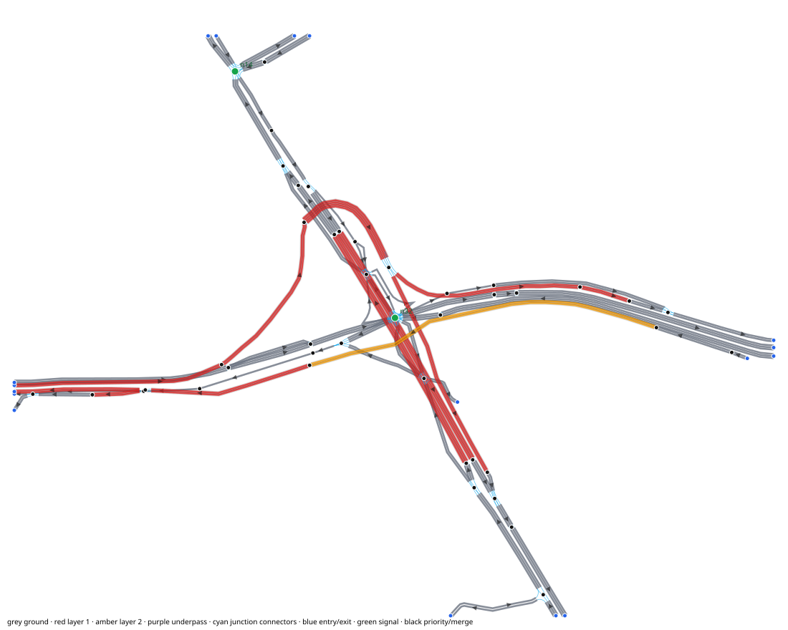

# Validation report

Every claim below is enforced by an automated test in `engine/test/` (run `npm test`: 70 tests) or
regenerated by a script in `engine/scripts/`. The model itself is described in [MODEL.md](MODEL.md).

Default driver: `v0 = speed limit, T = 1.0 s, a = 1.5 m/s², b = 2.0 m/s², s0 = 2 m, δ = 4`,
vehicle length 4.5 m, time step 0.25 s.

## Summary

| What | Reference | Simulation | Test file |
|---|---|---|---|
| Lane capacity | 1,800–2,200 veh/h/lane (textbook range) | 2,012 | `idm.test.ts` |
| Flow–density curve, stable regime | IDM equilibrium (analytic) | within 0.1 % | `roadSim.test.ts` |
| Saturation flow (queue discharge) | HCM 1,900; IRC ≈ 1,840 per 3.5 m lane | 1,935 | calibration, §2 |
| Signal capacity | s · g_eff / C = 1,488 veh/h (predicted before measuring) | 1,439 (−3.3 %) | `networkSim.test.ts` |
| Signal delay | Webster's formula | +1.4 to +2.9 s across x = 0.2–0.8 | `networkSim.test.ts` |
| Give-way junction, minor-road capacity | HCM gap acceptance | 20 % below HCM at 800 veh/h; more conservative above | `networkSim.test.ts` |
| 2→1 lane-drop capacity | ≤ one lane (2,012) | 1,889 (94 %) | `networkSim.test.ts` |
| Flyover isolation | through traffic unaffected by the junction below | 6 s delay while the junction has > 200 s | `networkSim.test.ts` |
| Braess's paradox | adding a link can slow everyone | ≥ 20 % slower at 1,600 veh/h | `networkSim.test.ts` |
| **Silk Board (OpenStreetMap), default demand** | busy but serviceable | ~95 % of trips done in the hour, no gridlock, worst braking 9.8 m/s² | `silkBoard.test.ts` |
| **Silk Board, 2× demand** | overloaded | entry queues of 1,000–1,200 vehicles | `silkBoard.test.ts` |

## 1. Single lane (Phase 1)

### Fundamental diagram (ring road)

Data: [`validation/fundamental-diagram.csv`](validation/fundamental-diagram.csv). Regenerate with
`cd engine && npx tsx scripts/fundamental-diagram.ts`. Setup: a 2 km single-lane ring, 30 min warm-up,
2 h of measurement, with one vehicle displaced 1 m to seed instabilities.

- **Lane capacity is 2,012 veh/h at 56 veh/km.**
- **At 5–70 veh/km, simulated flow matches IDM equilibrium to within 0.1 %.**
- **At 75 veh/km and above, stop-and-go waves form** and flow drops 13–17 % below the homogeneous
  equilibrium (IDM's string instability).
- **Near jam density the simulation beats the equilibrium curve** (109 vs 90 veh/h at 150 veh/km).
  This is not an error. Equilibrium assumes equal gaps, but stopped vehicles compress to 1.2–1.9 m
  (below s0, a known IDM property when braking to a stop), leaving more room for the rest.
  The gap always stays positive.

**Two independent flow measurements** (space-mean speed × density, and a point detector) agree
within 0.1 % in stable flow. In the wave regime they first disagreed by 12 % over a 30-minute window.
That turned out to be a measurement artefact: on a ring the detector count can be off by up to one
crossing per vehicle, i.e. ±400 veh/h for 200 vehicles over 30 min. Over 2 h they agree within 0.2 %.

### Entrance (source) capacity: a bug found and fixed

The first insertion rule (insert as soon as there is a 3 m gap, at the equilibrium speed for that gap)
let only **1,187 veh/h** onto a saturated road. Each vehicle entered nearly stopped right at the
entry point. Four rules compared at 3,000 veh/h demand:

| Rule | Entrance flow (veh/h) | Hardest braking |
|---|---|---|
| A. equilibrium speed for gap, gap ≥ s0 + 1 (original) | 1,221 | 0.00 m/s² |
| **B. leader's speed, gap ≥ s0 + vT (adopted)** | **2,009** | 0.73 m/s² |
| C. like A, but wait until speed ≥ 0.8 × leader | 1,957 | 0.00 m/s² |
| D. leader's speed, gap ≥ s0 + 1.2 vT | 1,916 | 0.43 m/s² |

## 2. Saturation flow: calibrating the driver

A junction's capacity is set by how fast a stopped queue drains. Measured by releasing 40 stopped
vehicles and timing headways from the 5th vehicle onward (HCM method):

| a (m/s²) | b | T | Capacity | Saturation flow | Start-up lost time |
|---|---|---|---|---|---|
| 1.0 | 1.5 | 1.0 | 2,012 | 1,809 | 6.2 s |
| **1.5** | **2.0** | **1.0** | **2,012** | **1,935** | **4.6 s** |
| 2.0 | 2.0 | 1.0 | 2,012 | 2,011 | 3.6 s |

`a = 1.5, b = 2.0` is adopted: closest to the HCM base saturation flow (1,900) and IRC guidance.
Its start-up lost time (4.6 s) is higher than HCM's typical 2 s, a known limitation.

## 3. Signalised junctions

One 2-lane approach, 30 s green + 3 s amber + 2 s all-red, then an equal phase for nobody (C = 70 s).

**Capacity.** Predicted before measuring: effective green = 30 + 3 − 4.6 − 1.5 = 26.9 s, so
2 × 1,935 × 26.9 / 70 = **1,488 veh/h**. Measured: **1,439** (−3.3 %; the test allows ±8 %).

**Delay vs Webster's formula** (2 h of measurement each):

| Demand (veh/h) | Degree of saturation | Webster | Simulated |
|---|---|---|---|
| 300 | 0.20 | 14.7 s | 16.4 s |
| 600 | 0.40 | 16.5 s | 18.2 s |
| 900 | 0.61 | 19.1 s | 22.0 s |
| 1,200 | 0.81 | 24.3 s | 25.7 s |

Webster leaves out the time spent slowing down and speeding up, so the simulation sits a little above it.

**Red-light behaviour.** No vehicle enters a junction after the all-red clearance has ended
(latest observed: 1.25 s after red begins, with 2 s all-red). Checked on every preset and on Silk Board.

## 4. Give-way junctions vs HCM

Single-lane major road, minor road merging into it with 600 veh/h demand. HCM potential capacity
uses a 6.2 s critical gap and 3.3 s follow-up time.

| Major flow (veh/h) | HCM minor capacity | Simulated | Major-road delay |
|---|---|---|---|
| 300 | 744 (all 600 served) | 594 | 5 s |
| 800 | 388 | 309 | 7 s |
| 1,200 | 228 | 102 | 10 s |
| 1,600 | 132 | 18 | 17 s |

The model is conservative, increasingly so at high major flow. See "Known limitations".

## 5. Merging

A 2→1 lane drop carries **1,889 veh/h**, 94 % of single-lane capacity. An earlier version treated
merging connectors like crossing ones (enter only when the other is empty) and managed about 650.

## 6. Flyover (synthetic preset)

A north–south arterial crosses a signalised junction on a flyover, with service roads to the
junction below (the Silk Board pattern).

- With the cross-road demand tripled, east–west delay exceeds 200 s while flyover traffic has
  **6 s** of delay. The deck has no movements at the junction it passes over (asserted on the built network).
- **Closing the flyover** sends through traffic via the service roads and the signal: north–south
  delay rises more than fivefold and total throughput falls. No vehicle uses a closed link.

## 7. Braess's paradox

Two routes, each with one single-lane bottleneck and one long wide road, in opposite order; plus an
optional short link joining them. At 1,600 veh/h (90 min, three seeds), the average trip with the
shortcut is at least 20 % slower than without it. The effect is larger than static Braess theory
predicts, because the single-lane bottleneck makes vehicles bound for the uncongested route queue
behind vehicles waiting for the shortcut. That spillback is real; static equilibrium theory leaves it out.

## 8. Silk Board junction, Bengaluru (OpenStreetMap, Phase 3)

Grey: ground roads. Red: layer-1 decks (Silk Board Flyover over the junction; double-decker
flyover and ramps). Amber: the layer-2 interchange ramp. Green dots: signals. Blue: entries/exits.

**Pipeline** (see [data/README.md](../data/README.md)): OSM extract (`data/raw/silk-board.osm.json`,
committed) → `data/build_network.py` → `networks/silk-board.network.json` →
`engine/scripts/osm-demand.ts` → `networks/silk-board.json` (network + synthetic demand + designed
lanes and signal timings). Map data © OpenStreetMap contributors, ODbL 1.0.

**Result at the default demand** (120 veh/h per entry lane, 2,280 veh/h in total; 1 h, 5 seeds):

| Seed | Trips done in the hour | Waiting to enter | Mean trip | Gridlock | Removed | Braking > 5 m/s² | Worst braking |
|---|---|---|---|---|---|---|---|
| 1 | 95.7 % | 0 | 161 s | none | 0 | 56 vehicles | 8.3 m/s² |
| 2 | 94.4 % | 0 | 167 s | none | 0 | 74 | 9.5 |
| 3 | 95.3 % | 0 | 156 s | none | 0 | 79 | 9.2 |
| 4 | 95.3 % | 0 | 161 s | none | 0 | 66 | 9.0 |
| 5 | 95.6 % | 0 | 161 s | none | 0 | 93 | 9.8 |

The ~5 % not done are still under way when the hour ends. At **2× demand** the area is overloaded:
1,000–1,200 vehicles wait to enter, 66–71 % of entered trips finish within the hour, and gridlock
relief removes about 100 vehicles an hour.

**Closing the Silk Board Flyover** (`silkBoard.test.ts`): northbound through traffic reroutes through
the signalised junction and every affected trip gets slower. Southbound through traffic has **no**
route at all: in the OSM data the only way past Silk Board towards Hosur Road south is the flyover
itself, even with every road class included. Those trips are reported as unserved demand.

### What it took to get there

The real network broke the model in ways the synthetic presets never did. At first, even the
lowest demand gridlocked within 9 minutes. Each fix below was found by tracing a specific failure.

**Data preparation**

| Problem found | Fix |
|---|---|
| A big junction is several OSM nodes; links between them were 5–23 m long after junction trimming, too short for a lane change or to hold a car | join junctions whenever a link would keep < 20 m of usable road, using the engine's own trimming radius |
| A short ramp piece could pull a flyover node into the junction below | never join nodes on different levels (17 such joins refused at Silk Board) |
| A signal tagged near a flyover could attach to the deck | signals attach only to junctions on their own level |
| A lone signal tag (pedestrian crossing) on a single approach stopped traffic every 30 s | a signal needs ≥ 2 approaches |
| Drain and canal bridges (9–23 m) were treated as flyovers, blocking junction joins | bridges < 30 m that cross no road are ground level; an 88 m deck piece is kept elevated |
| A dead-end stub looped back to its junction and was treated as an entry point mid-network | remove dead-end stubs; write every node's type explicitly |
| A "duplicate" rule dropped a 2-lane service road beside a 3-lane carriageway | keep parallel links |
| Tertiary streets added unsignalised crossings and imputed attributes | keep trunk/primary/secondary roads; keep a tertiary road only if it is a simple chain joining kept roads at both ends (service roads) |
| Removing them cut the double-decker ramps, which were pruned | a kept road whose continuation was removed ends as an entry/exit |

**Engine (all also regression-tested on the synthetic presets)**

| Problem found | Fix |
|---|---|
| Leader lookup on a connector returned the own-lane leader and missed a nearer vehicle on the merging connector: a collision at a lane drop | consider side leaders on connectors too |
| A vehicle approved for a merging connector was invisible while that connector was occupied, then "appeared" 2 m ahead | always consider the approved vehicle |
| Left-turners reached a queued approach in the wrong lane | lane choice looks 4 movements ahead (was 2); planned lane changes also ask the target lane for room |
| Webster timing used the approach's average lane flow; one left-turn lane was at 2.3× capacity | time signals on the busiest (critical) lane; design lane use for the demand |
| Vehicles created at 15–20 m/s on 29–56 m entry links could not stop for the junction ahead | enter no faster than allows a comfortable stop before the link's end |
| Drivers reacted to a signal only on its approach link | decide from 100 m before the stop line, tied to that signal |
| A wrong-lane follower behind a leader that could go met the stop line 16 m ahead | wrong-lane vehicles prepare to stop at the line |
| Followers approaching a give-way point or a lane drop at speed were refused 20 m out | keep a speed from which a comfortable stop is still possible |
| Equal-priority merges refused a follower on comfort grounds, forcing a far harder stop | choose the lesser harm |
| A lane change cut in front of an approved vehicle, putting two cars side by side at a merge | no lane change in front of an approved vehicle (and an invariant for it) |
| Approvals were withdrawn from vehicles too close to stop, or kept by crawling vehicles through a whole red | withdraw only if a stop at ≤ 2.5 m/s² average is still possible, measured to where the car stops |
| One local lock-up froze the network for the rest of the run | gridlock relief as in SUMO: remove the head of a queue stopped 300 s, and count it |

## 9. Safety invariants

Checked **after every step** for 1 h on all five presets, every 4th step for 2 h at 2.5× demand,
and every 4th step on Silk Board:

| Invariant | Notes |
|---|---|
| No collisions within a lane | gap ≥ 0 for every leader/follower pair |
| No collisions across lane boundaries | junction connector → the lane it feeds; stop line → connector |
| Crossing junction paths never occupied together | |
| Merging and diverging vehicles never overlap | ordered by distance to the merge point |
| Only the front vehicle of a lane holds a junction approval | |
| Vehicle conservation | entered = exited + removed + in network; demand = entered + waiting + unserved |
| No stop-line violations | no vehicle crosses a stop line without permission |
| Determinism | same seed → bit-identical state hash |
| No emergency braking | ≤ 5 m/s² on the presets at design demand (≤ 8 at the Braess merge), < 12 on Silk Board, ≤ 1 g under overload |

**The braking metric found the bugs the collision check missed.** A gap of nearly zero shows up as
an enormous deceleration before it shows up as an overlap. Tracking the hardest braking exposed
values from −30 to −10⁹ m/s² and led to most of the fixes listed in Phase 2 and §8.

Phase 2 fixes:

| Bug | Fix |
|---|---|
| Lane change at the start of a link cut off a vehicle about to arrive from the junction | lane-change check looks upstream into feeding connectors |
| Lane change at the end of a link moved into the overhanging tail of a vehicle that had just left | lane-change check looks downstream at connectors leaving the target lane |
| The collision check itself only looked within lanes | extended across every lane boundary |
| A vehicle waiting at a stop line overlapped a vehicle stopped just inside the junction | the stop-line obstacle is brought nearer by any overhanging tail |
| A minor-road vehicle could pull out 3 s ahead of a 60 km/h vehicle | speed-aware rule: it may not make priority traffic slow by more than 1.5 m/s² |
| Permanent deadlock: a vehicle in the wrong lane at a stop line with no alternative route | lane choice ahead; cooperative merging; last-resort removal (counted) |
| Merge capacity half of realistic | zipper merging by car-following |
| Stale travel times: an empty link kept its last congested reading | an empty link costs its free-flow time |

**Gridlock is real, not a fault.** At 2.5× demand the grid locks up. Tracing each stuck queue to the
link it waits on gives a closed loop around one block, each link full and waiting on the next.

## 10. Edge cases (Phase 7)

Run through `runScenario` (the code path the app and the server use) on Silk Board unless noted.
None crashed; each failure mode is reported in the results rather than hidden.

| Scenario | Outcome |
|---|---|
| Zero demand | Empty run, all measures 0 |
| Every road closed | 0 trips entered; all 400 generated trips reported as "no route"; one warning per unreachable origin–destination pair |
| Both flyovers closed, 30 min | 600 trips done, 399 with no route (southbound through traffic has no ground route), 7 removed by gridlock relief |
| 3× demand, 2 h | Gridlock flagged at 15:00; 7,297 vehicles waiting to enter; 321 removed by gridlock relief and the wrong-lane rule (5 %); **hardest braking 12.7 m/s²** |
| 3× demand, 2 h, signals retimed | Gridlock at 17:00; similar totals; hardest braking 11.3 m/s² |
| Every signal phase at the 5 s minimum | Runs; mean travel time 208 s vs 160 s at the designed timings |
| Every road 1 lane of 2.5 m | Runs; slower (301 s mean travel time), 38 waiting at the end |
| Every road 6 lanes | Runs; fastest (165 s) |
| Each network at 3× demand, retimed | All complete; Silk Board and the grid flag gridlock, the others queue at their entrances |

**Finding:** under heavy overload the worst single braking event exceeds the 9.8 m/s² seen at
normal demand (12.7 m/s² at 3× demand over two hours). Where it happens has not been
investigated; it is listed under known limitations and was not chased further.

## Known limitations

- **Demand is synthetic.** Nothing is calibrated against observed counts; results show relative
  effects of scenarios, not predictions for a real place. Silk Board demand favours through traffic
  (destinations weighted by distance²) but is otherwise a simple gravity pattern.
- **Silk Board omits tertiary streets** (except service-road chains). Their lane counts and speeds
  were mostly imputed, and they added unsignalised crossings that dominated gridlock.
- **Lane counts and speed limits are partly imputed.** At Silk Board, a default by road class was
  used 65 times for a lane count and 65 times for a speed limit (counted per way and direction; see
  `meta.imputed` in the network file). No way had turn-lane tags, so lane use per turn is designed
  from the demand.
- **Side roads next to a saturated, free-flowing main road get almost nothing.** HCM predicts about
  76 veh/h at 2,000 veh/h of major flow; the model gives 0. A "courtesy yield" was tried and
  rejected: one stop turned the main road into a queue and cut its throughput from 1,564 to 1,046 veh/h.
- **Minor-road capacity is below HCM** (20 % at 800 veh/h, more at higher flows).
- **Start-up lost time is 4.6 s**, against HCM's typical 2 s.
- **Gridlock relief removes vehicles** (about 100 an hour at 2× demand on Silk Board). They are
  counted and reported, never hidden.
- **Firm braking.** 2–4 % of vehicles at Silk Board brake harder than 5 m/s² at some point, mostly at
  one 2→1 lane drop into a 30 km/h slip road; the worst over five seeds is 9.8 m/s². Under heavy
  overload (3× demand) single events reach 11–13 m/s² (§10; location not investigated).
- **Homogeneous vehicles** (cars only) and lane-based driving; no two-wheeler filtering.
- **Routing is reactive** (current measured travel times at departure), not a predictive equilibrium.
